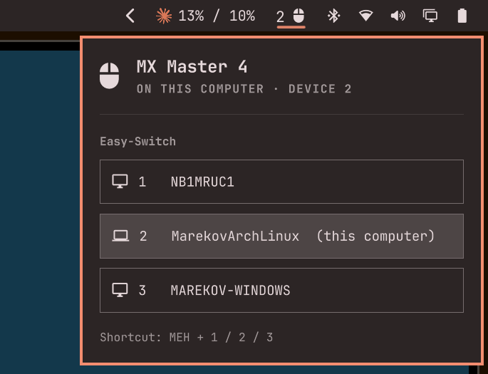

# Marekov Easy MX Master Switcher

A small Windows tray app that shows which computer a **Logitech MX Master 4** is connected to and
switches its **Easy-Switch** channel (1 / 2 / 3) from software: one click in a tray panel or a
global keyboard shortcut, instead of reaching under the mouse for its button.

It is the Windows twin of a Linux setup that already works (an Omarchy bar widget plus the
`mx-host` script). Both look and behave the same, so the mouse can be sent back and forth from
either side.

## Status

🚧 **Not implemented yet.** The full spec for the implementing agent is in [`TODO.md`](TODO.md).

## How it works (short version)

The Easy-Switch button just tells the mouse "go to channel N". That is Logitech's HID++ 2.0
feature `0x1814` (CHANGE_HOST), and any program that can write to the mouse's HID++ interface
can send it too. Feature `0x1815` (HOSTS_INFO) gives the names of the paired computers.
No Logitech software is needed.

Once the mouse switches away, the computer it left can no longer talk to it, so the way back
is the same app (or the Linux script) on the other computer.

## Repository layout

| Path | What |
|---|---|
| `TODO.md` | Implementation spec and checklist for the Windows app |
| `reference/linux/mx-host.py` | Working Linux implementation of the HID++ protocol (the source of truth) |
| `reference/linux/Panel.qml` | The Linux bar widget (Quickshell / Qt Quick) whose look the Windows UI copies |
| `reference/screenshots/` | How the Linux panel looks, connected and away |

## License

MIT
