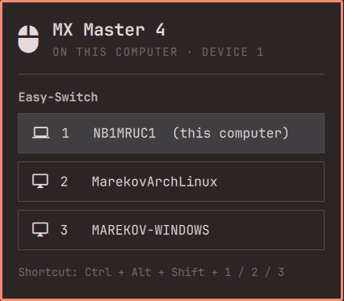
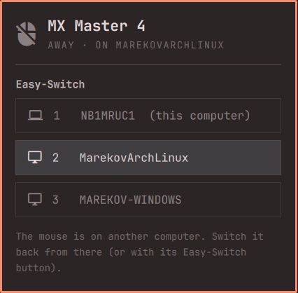

# Marekov Easy MX Master Switcher

A small Windows tray app that shows which computer a **Logitech MX Master 4** is connected to and
switches its **Easy-Switch** channel (1 / 2 / 3) from software: one click in a tray panel or a
global keyboard shortcut, instead of reaching under the mouse for its button.

It is the Windows twin of a Linux setup that already works (an Omarchy bar widget plus the
`mx-host` script). Both look and behave the same, so the mouse can be sent back and forth from
either side.

| Windows, connected | Windows, away | Linux |
|---|---|---|
|  |  |  |

## Status

The tray app is implemented and works (see below). Day to day, though, the mouse and keyboard are
now shared over the network with lan-mouse; see [`LAN-MOUSE.md`](LAN-MOUSE.md) and
*Windows lan-mouse setup* below.

## Use

- **Tray icon**: the channel number next to a mouse glyph while the mouse is here. While it is
  away, the icon is a dimmed, crossed-out mouse. The tooltip says where the mouse is.
- **Left-click** the icon to open the panel, then click a channel, or use ↑ / ↓ and Enter.
  Esc or clicking elsewhere closes it.
- **Ctrl + Alt + Shift + 1 / 2 / 3** sends the mouse to that channel from anywhere. These are the
  physical number-row keys, so they work on the Slovak layout too.
- **Right-click** the icon for *Refresh*, *Start with Windows* and *Quit*.
- Starting the app again while it runs just opens its panel.

The state cache (channel names, this computer's channel, where the mouse was sent) and a log are
in `%LOCALAPPDATA%\MarekovEasyMxMasterSwitcher\`.

## Install / run

Download `MarekovEasyMxMasterSwitcher.exe` from the releases, or build it (below), and run it.
No installer and no admin rights are needed.

To run from source (Python 3.12):

```bash
py -3.12 -m venv .venv
```

```bash
.venv\Scripts\python -m pip install -r requirements.txt
```

```bash
.venv\Scripts\pythonw src\main.py
```

## Build

```bash
powershell -ExecutionPolicy Bypass -File build.ps1
```

This produces `dist\MarekovEasyMxMasterSwitcher.exe` (PyInstaller, one file, windowed). Pushing
a `v*` tag runs the same build on GitHub Actions and attaches the exe to a release.

## How it works

The Easy-Switch button just tells the mouse "go to channel N". That is Logitech's HID++ 2.0
feature `0x1814` (CHANGE_HOST), and any program that can write to the mouse's HID++ interface
can send it too. Feature `0x1815` (HOSTS_INFO) gives the names of the paired computers.
No Logitech software is needed.

On Windows the mouse (Bluetooth, product ID `0xB042`) shows up as three HID collections. HID++
works on the vendor one, usage page `0xFF43` / usage `0x0202`, which accepts the 20-byte report
`0x11`. When the mouse is on another channel, the device disappears from Windows entirely, so
polling while it is away costs nothing.

Once the mouse switches away, the computer it left can no longer talk to it, so the way back
is the same app (or the Linux script) on the other computer.

| Path | What |
|---|---|
| `AGENTS.md` / `CLAUDE.md` | Start here if you are a coding agent |
| `LAN-MOUSE.md` | **Current task:** Windows side of the lan-mouse setup |
| `TODO.md` | On hold: implementation spec and checklist for the Windows app |
| `src/mxswitcher/hidpp.py` | HID++ protocol, ported from `mx-host.py` |
| `src/mxswitcher/device.py` | State cache, status, switch flow |
| `src/mxswitcher/hotkeys.py` | Global hotkeys (`RegisterHotKey` on its own message-loop thread) |
| `src/mxswitcher/app.py` | Tray, toasts, polling, autostart, single instance, colour tokens |
| `src/mxswitcher/Panel.qml` | The panel (port of `reference/linux/Panel.qml`) |
| `reference/linux/` | The Linux side (mx-host, Panel.qml, lan-mouse config and unit), for reference only |
| `reference/screenshots/` | How the Linux panel looks, connected and away |

## Windows lan-mouse setup

Done on the Windows laptop following [`LAN-MOUSE.md`](LAN-MOUSE.md), with these differences:

- **Hostname is `NB1MRUC1`**, not `MAREKOV-WINDOWS`, so the Linux client must use the IP:
  **`192.168.1.119`** (Wi-Fi "Marekova WIFI 2"). Its Easy-Switch channel is 1, too.
- **Install:** lan-mouse **v0.11.0** (`lan-mouse-windows-x86_64.zip`, SHA-256 checked against the
  release) unpacked to `%LOCALAPPDATA%\Programs\lan-mouse\`.
- **Config:** `%LOCALAPPDATA%\lan-mouse\config.toml` (this is the one 0.11.0 uses on Windows; the
  certificate `lan-mouse.pem` is next to it). Port 4242, with the Linux fingerprint authorized as
  `MarekovArchLinux`. Windows only receives; no client back to Linux is configured.
- **Windows fingerprint**, if the Windows → Linux direction is added later:
  `0f:2e:ab:c2:e3:2c:a6:3f:34:85:64:bc:a4:c1:37:36:1e:04:9a:bf:a7:46:1d:46:ad:7a:0d:4e:c3:7e:ce:e3`
- **Autostart:** `lan-mouse.lnk` in the user's Startup folder, running
  `conhost.exe --headless "<install dir>\lan-mouse.exe" daemon`. `lan-mouse.exe` is a console
  program, and `--headless` keeps the console window from showing.
- **Firewall:** on first run Windows added its own inbound *Allow* rules for `lan-mouse.exe` on the
  Domain and Public profiles. The Wi-Fi is currently *Public*, so that works. The cleaner setup
  from `LAN-MOUSE.md` (Wi-Fi set to *Private*, UDP 4242 allowed on Private only) needs admin rights
  and is left for the user to do.

## Logi Options+

It works alongside Logi Options+: everything was built and tested with Options+ running.
Both programs can use the HID++ interface at the same time, and the app only matches replies
to its own requests.

## Known limitations

- The one-file exe unpacks itself to a temp folder on every start, so it takes a few seconds
  to appear.
- Notifications use the tray balloon API. Windows shows them as toasts titled with the exe name,
  and a new one replaces the one on screen instead of stacking.
- The panel opens in the bottom-right corner of the screen that has the tray icon (top-right
  with a top taskbar), not exactly above the icon.
- Only the MX Master 4 over Bluetooth is supported (`PRODUCT_ID` in `hidpp.py`). Bolt and
  Unifying receivers are not handled.

## License

MIT. The bundled JetBrainsMono Nerd Font is under the
[SIL Open Font License](https://github.com/ryanoasis/nerd-fonts/blob/master/LICENSE).
